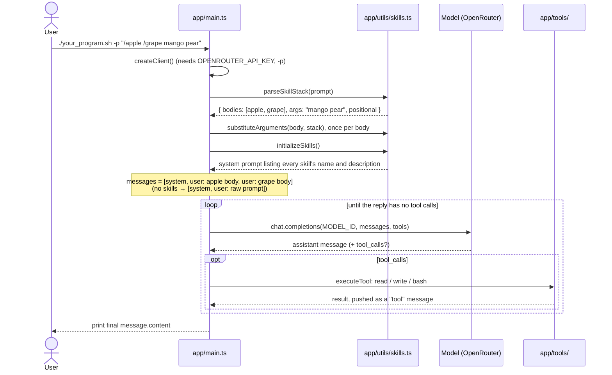
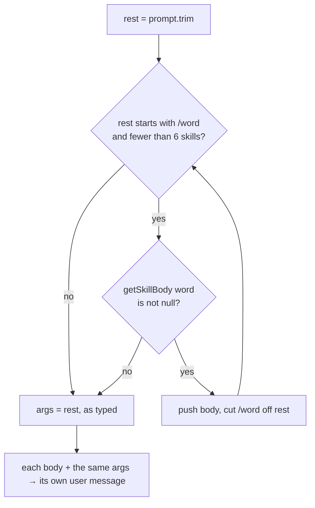

# Workflow

How the program runs right now. Update this file in the same change as any code that alters the flow.

_Last updated: 2026-11-10 (skill stacking)_

## Runtime sequence

## Skill stacking (`parseSkillStack`)

## Rules

- A skill is `.claude/skills/<name>/SKILL.md`: frontmatter (`name`, `description`) between `---` lines, then the body.
- `$ARGUMENTS` becomes the full argument string. `$0`, `$1`, … become the arguments split on whitespace, counting from 0. Substitution happens in one pass, so inserted values are never expanded again.
- Examples: `/apple /grape mango pear` gives 2 skills with args `mango pear`. `/apple /nope 1` gives 1 skill with args `/nope 1`. `hello /apple` gives no skills, so the raw prompt is sent.
- Real Claude Code stacks skills only at the interactive prompt. In `-p` mode it expands just the first. We stack in `-p` on purpose.

## Known gaps / next up

Compared with the [Claude Code skills docs](https://code.claude.com/docs/en/skills#pass-arguments-to-skills):

- [ ] Add `ARGUMENTS: <args>` to the end when no placeholder takes the arguments.
- [ ] A missing index (`$2` with only 2 arguments) should stay as literal `$2`. Right now it becomes `""`.
- [ ] `$ARGUMENTS[N]` as another way to write `$N`.
- [ ] Shell-style quoting: `"hello world"` as one argument.
- [ ] Named arguments from an `arguments:` frontmatter list. The types exist in `app/types.ts` but nothing uses them yet.
- [ ] `\$1` escape.
- [ ] Skill files are split on `---`, so a body containing `---` gets cut off.
