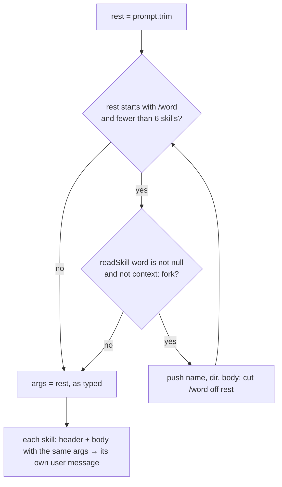

# Workflow

How the program runs right now. Update this file in the same change as any code that alters the flow.

_Last updated: 2026-11-12 (LSP goToDefinition: didOpen once per file, then textDocument/definition)_

## Runtime sequence

```mermaid
sequenceDiagram
    actor User
    participant Main as app/main.ts
    participant Skills as app/utils/skills.ts
    participant Model as Model (OpenRouter)
    participant Tools as app/tools/
    participant LSP as app/lsp_client.ts

    User->>Main: ./your_program.sh -p "/apple /grape mango pear"
    Main->>Main: createClient() (needs OPENROUTER_API_KEY, -p)
    Main->>LSP: LSPClient.fromEnvironment()
    LSP-->>Main: client (CODECRAFTERS_LSP_URL set) or null
    Note over Main: client → stderr "LSP client connected"; kept in lspClient for the run
    Main->>Skills: expandPrompt(prompt)
    Note over Skills: parseSkillStack → skills [{name, dir, body}] for apple, grape, args "mango pear"<br/>per skill: renderSkill = skillHeader + "\n\n" + substituteArguments(body, stack)
    Skills-->>Main: ["apple header + body", "grape header + body"] (no skills → [prompt])
    Main->>Skills: initializeSkills()
    Skills-->>Main: system prompt listing every skill's name and description,<br/>plus "call the Skill tool if a skill matches"
    Note over Main: messages = [system, user: apple header + body, user: grape header + body]<br/>(no skills → [system, user: raw prompt])
    Note over Main: runAgent(client, messages): the agent loop, returns the final answer
    loop until the reply has no tool calls
        Main->>Model: chat.completions(MODEL_ID, messages, tools + LSP if lspClient)
        Model-->>Main: assistant message (+ tool_calls?)
        opt tool_calls
            Main->>Tools: executeTool: read / write / bash
            Main->>Skills: executeTool: Skill {name, args?} → loadSkill → {text, fork}
            opt fork (context: fork)
                Main->>Main: runAgent(client, [user: text]) — subagent, fresh conversation
                Note over Main: result = "Skill <name> ran in a separate context and returned: <answer>"
            end
            Main->>LSP: executeTool: LSP {operation, filePath, line, character} → goToDefinition (app/tools/lsp.ts)
            Note over Main,LSP: first lookup of a file: notify textDocument/didOpen {uri, languageId, version 1, text}<br/>then request textDocument/definition at (line-1, character-1)
            LSP-->>Main: Location {uri, range} → "Defined in <relative path>:<line+1>:<char+1>"
            Note over Main: result (or "Error: <message>" if it threw), pushed as a "tool" message
        end
    end
    Main-->>User: print runAgent's answer
```

## Skill stacking (`parseSkillStack`)



## Rules

- A skill is `.claude/skills/<name>/SKILL.md`: frontmatter (`name`, `description`) between `---` lines, then the body. `readSkill` is the only code that reads this format. Both the skill list (`initializeSkills`) and stacking use it.
- A skill folder can bundle files next to `SKILL.md` (e.g. `scripts/checksum.sh`). The body names them relative to the skill's folder. Each skill message starts with `Skill: <name> (located at .claude/skills/<name>)` and `Paths in the instructions below are relative to that folder.`, then a blank line and the body. The folder is project-relative, because the `bash` tool runs from the project root. The model joins folder and path and runs the script with `bash`; there is no special script-running code.
- `$ARGUMENTS` becomes the full argument string. `$0`, `$1`, … become the arguments split on whitespace, counting from 0. Substitution happens in one pass, so inserted values are never expanded again.
- Examples: `/apple /grape mango pear` gives 2 skills with args `mango pear`. `/apple /nope 1` gives 1 skill with args `/nope 1`. `hello /apple` gives no skills, so the raw prompt is sent.
- A skill reaches the model in two ways, with the same text (`renderSkill`: header + body with args filled in):
  - The user names it: `/name` at the start of the prompt, expanded before the first request (`expandPrompt`).
  - The model picks it: the system prompt lists every skill and says to call the `Skill` tool when one matches. `Skill {name, args?}` returns the skill via `loadSkill`. An unknown name is an error the model sees. Only the chosen skill's body is loaded, never the others.
- A skill with `context: fork` runs in a subagent. When the model calls `Skill` on it, the handler runs `runAgent` again over a new conversation holding only the skill's text (header + body, args filled in). That conversation has no system prompt and doesn't include the user's question. Only the subagent's final answer comes back, as `Skill <name> ran in a separate context and returned: <answer>`. The subagent has the same tools as the main loop.
- A fork skill ends a stacking run: `/apple /fig 1` (fig forks) expands only apple, with args `/fig 1`. `/fig` alone expands nothing, so the raw prompt is sent and the model can still call `Skill`.
- A tool that throws (e.g. `read` on a directory) never crashes the program. `clientLoop` catches it and sends `Error: <message>` back as the tool result, so the model can recover.
- LSP: `main()` calls `LSPClient.fromEnvironment()` before the first model request. It returns `null` unless `CODECRAFTERS_LSP_URL` is set. When connected, it logs `LSP client connected` to stderr (stdout is only the answer) and every request, subagents included, advertises the `LSP` tool (`goToDefinition`; `line`/`character` 1-based). `goToDefinition` (`app/tools/lsp.ts`) resolves `filePath` against the working directory into a percent-encoded `file://` URI, sends `textDocument/didOpen` (languageId from `extensionToLanguage[ext]`, version 1, full text) the first time that URI is used, then requests `textDocument/definition` with 0-based positions. Opened URIs are kept in a set for the run. The server rejects a second `didOpen`, and a URI goes into the set only after `notify` succeeds. The reply's start position comes back as `Defined in <path relative to cwd>:<line>:<char>` (1-based). Unconfigured, the tool isn't offered and nothing else changes.
- Real Claude Code stacks skills only at the interactive prompt. In `-p` mode it expands just the first. We stack in `-p` on purpose.

## Known gaps / next up

Compared with the [Claude Code skills docs](https://code.claude.com/docs/en/skills#pass-arguments-to-skills):

- [ ] Add `ARGUMENTS: <args>` to the end when no placeholder takes the arguments.
- [ ] A missing index (`$2` with only 2 arguments) should stay as literal `$2`. Right now it becomes `""`.
- [ ] `$ARGUMENTS[N]` as another way to write `$N`.
- [ ] Shell-style quoting: `"hello world"` as one argument.
- [ ] Named arguments from an `arguments:` frontmatter list.
- [ ] `\$1` escape.
- [x] ~~Skill files are split on `---`, so a body containing `---` gets cut off.~~ Fixed in `readSkill`.
- [x] ~~Bundled `scripts/`: the model doesn't know the skill's folder.~~ Fixed with the header in `expandPrompt`.
- [ ] `${CLAUDE_SKILL_DIR}` substitution in the body, like Claude Code.
- [ ] `references/` and `assets/` (named the same way as `scripts/`, but not tested in this stage).
- [x] ~~The model can't load a skill it picks from the list.~~ Fixed with the `Skill` tool.
- [ ] The model may call `Skill` for a skill already expanded from `/name` (seen in #SK5). Not harmless: if it calls `Skill` without `args`, `$ARGUMENTS` comes back empty and the model may echo that (#SK5 failed once this way, then passed on rerun).
- [ ] `/name` on a fork skill should run the subagent directly, like Claude Code. Now it falls through to the raw prompt.
- [ ] The `agent` frontmatter field (subagent type). Out of scope for this stage.
- [ ] Tool registry: keep each tool's schema and handler together, so a new tool (e.g. a sub-agent `Task`) is one file instead of edits in `tools/index.ts`, `main.ts` and `types.ts`. (LSP was the fifth tool added this way.)
- [x] ~~LSP `goToDefinition` handler~~ Done in `app/tools/lsp.ts`.
- [ ] LSP: several locations (`Location[]`), `LocationLink`, `null` results, and server errors aren't handled. Only a single `Location` is.
- [ ] LSP: edited files are never re-synced (`didChange`). The server keeps the text from the first `didOpen`.

Refactor queue (simplify without adding new ideas):

- [x] 1. `expandPrompt` in `skills.ts`; `main.ts` only maps strings to user messages.
- [x] 2. One `readSkill` helper plus a `SKILLS_DIR` constant, shared by `initializeSkills` and `parseSkillStack`. Fixes the `---` gap.
- [x] 3. Tidy `skills.ts`: drop `yamlParser`, use one export style, remove unused exports and the unused `Skill` type and `arguments` field.
- [x] 4. `executeTool`: parse tool arguments once before the `switch`.
