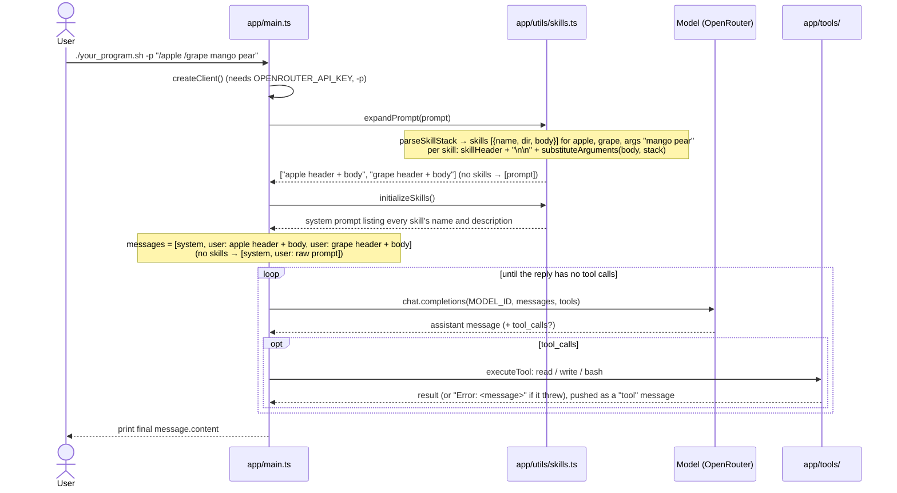
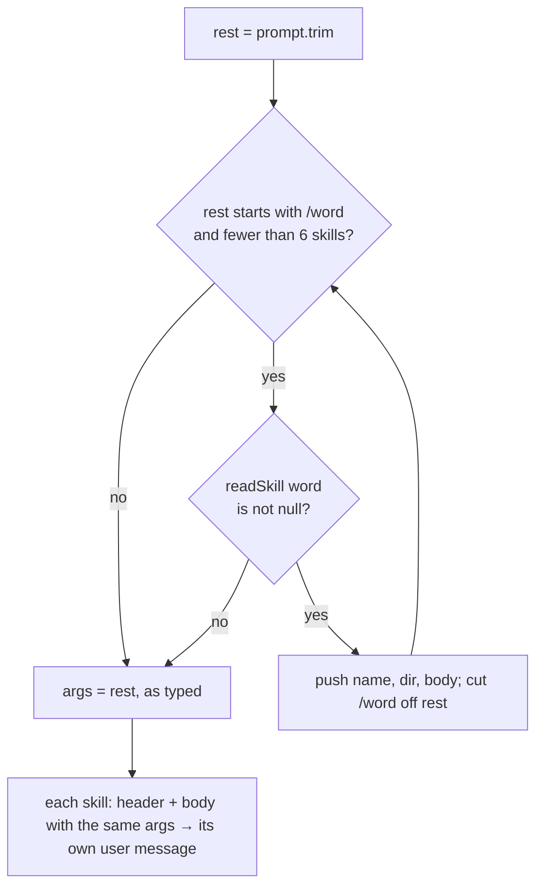

# Workflow

How the program runs right now. Update this file in the same change as any code that alters the flow.

_Last updated: 2026-11-11 (tool errors go back to the model instead of crashing)_

## Runtime sequence

## Skill stacking (`parseSkillStack`)

## Rules

- A skill is `.claude/skills/<name>/SKILL.md`: frontmatter (`name`, `description`) between `---` lines, then the body. `readSkill` is the only code that reads this format. Both the skill list (`initializeSkills`) and stacking use it.
- A skill folder can bundle files next to `SKILL.md` (e.g. `scripts/checksum.sh`). The body names them relative to the skill's folder. Each skill message starts with `Skill: <name> (located at .claude/skills/<name>)` and `Paths in the instructions below are relative to that folder.`, then a blank line and the body. The folder is project-relative, because the `bash` tool runs from the project root. The model joins folder and path and runs the script with `bash`; there is no special script-running code.
- `$ARGUMENTS` becomes the full argument string. `$0`, `$1`, … become the arguments split on whitespace, counting from 0. Substitution happens in one pass, so inserted values are never expanded again.
- Examples: `/apple /grape mango pear` gives 2 skills with args `mango pear`. `/apple /nope 1` gives 1 skill with args `/nope 1`. `hello /apple` gives no skills, so the raw prompt is sent.
- A tool that throws (e.g. `read` on a directory) never crashes the program. `clientLoop` catches it and sends `Error: <message>` back as the tool result, so the model can recover.
- Real Claude Code stacks skills only at the interactive prompt. In `-p` mode it expands just the first. We stack in `-p` on purpose.

## Known gaps / next up

Compared with the [Claude Code skills docs](https://code.claude.com/docs/en/skills#pass-arguments-to-skills):

- [ ] Add `ARGUMENTS: <args>` to the end when no placeholder takes the arguments.
- [ ] A missing index (`$2` with only 2 arguments) should stay as literal `$2`. Right now it becomes `""`.
- [ ] `$ARGUMENTS[N]` as another way to write `$N`.
- [ ] Shell-style quoting: `"hello world"` as one argument.
- [ ] Named arguments from an `arguments:` frontmatter list.
- [ ] `\$1` escape.
- [x] ~~Skill files are split on `---`, so a body containing `---` gets cut off.~~ Fixed in `readSkill`.
- [x] ~~Bundled `scripts/`: the model doesn't know the skill's folder.~~ Fixed with the header in `expandPrompt`.
- [ ] `${CLAUDE_SKILL_DIR}` substitution in the body, like Claude Code.
- [ ] `references/` and `assets/` (named the same way as `scripts/`, but not tested in this stage).

Refactor queue (simplify without adding new ideas):

- [x] 1. `expandPrompt` in `skills.ts`; `main.ts` only maps strings to user messages.
- [x] 2. One `readSkill` helper plus a `SKILLS_DIR` constant, shared by `initializeSkills` and `parseSkillStack`. Fixes the `---` gap.
- [x] 3. Tidy `skills.ts`: drop `yamlParser`, use one export style, remove unused exports and the unused `Skill` type and `arguments` field.
- [x] 4. `executeTool`: parse tool arguments once before the `switch`.
